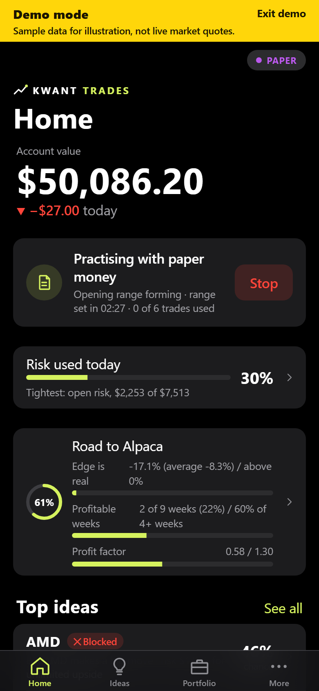
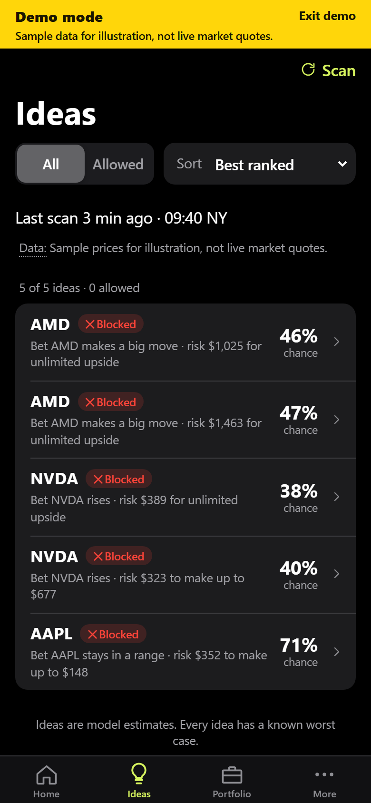
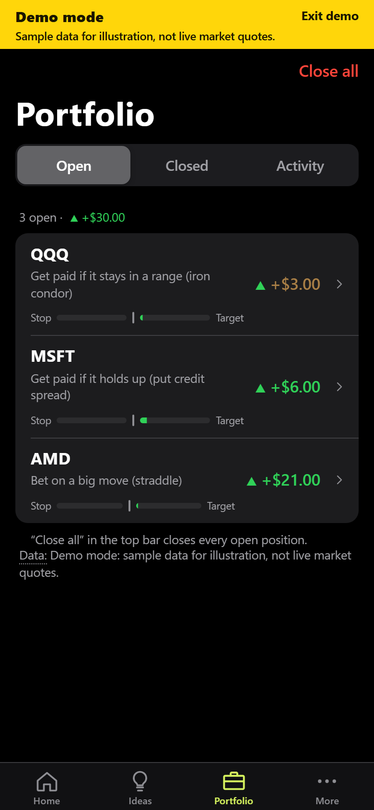
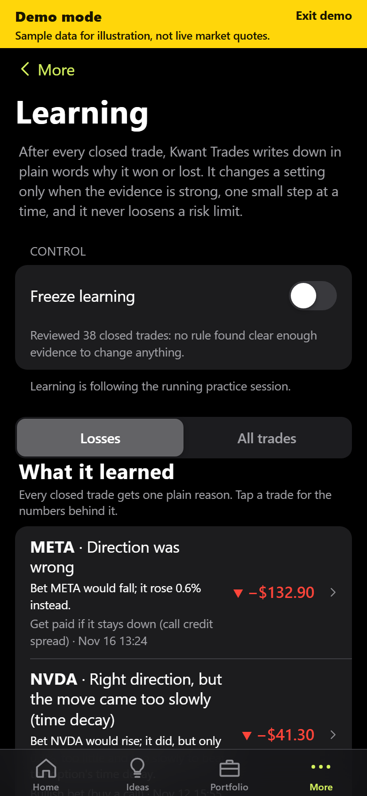
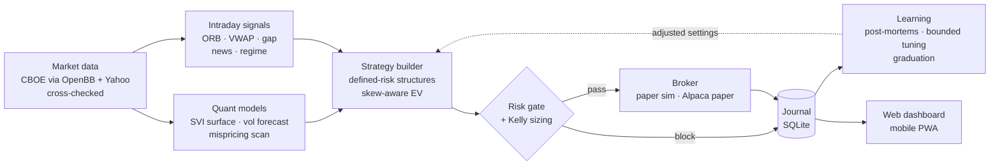

# Kwant Trades

**An options research and paper-trading system that finds mispriced US equity options with quantitative
volatility models, combines them with intraday price-action signals, and trades defined-risk spreads behind a
strict risk gate. It learns from its own losing trades and has to earn its way from simulation to a real
broker's practice account.**

**[▶ Open the live demo](https://kelsonlam.github.io/kwant-trades/)**: runs in any browser, no install or sign-up.


| Home | Trade ideas | Portfolio | Learning from losses |
|---|---|---|---|
|  |  |  |  |

<sub>Screens from the demo site (sample data). The dashboard is a mobile-first web app that installs to a phone's home screen.</sub>

## Highlights

**Quantitative pricing**
- **Volatility surface:** an SVI fit for each expiry, with Durrleman no-arbitrage checks. American options are
  priced with a Leisen-Reimer binomial tree.
- **Volatility forecasting:** a blend of EWMA, GARCH(1,1), HAR-RV and Yang-Zhang estimators, compared against
  the market's implied volatility.
- **Mispricing scan:** each option is compared with a local fair-volatility estimate built from its
  neighbouring strikes, with noise scaling and stale-quote rejection. On SPY this cut false flags from 532 to 0.
  It also checks put-call parity, butterfly spreads and calendar spreads.
- **Skew-aware expected value:** a Breeden-Litzenberger risk-neutral density, mapped to a physical
  distribution on a trading-session variance clock. This replaced a symmetric lognormal, which was biased
  towards selling puts.

**Day-trading signals**
- Built from scratch: 15-minute opening-range breakout, VWAP trend, gap continuation or fade, a news-sentiment
  lexicon, and a market-regime filter (SPY trend, VIX level and VIX term structure).

**Risk and execution**
- **Defined-risk structures only:** verticals, iron condors, and long calls, puts and straddles.
- **Sizing:** fractional Kelly, capped by a per-trade risk budget.
- **Risk gate:** about a dozen checks before every order, all journaled with reasons:
  - loss caps: per-trade loss and the daily loss limit, with a kill switch
  - exposure: open positions, portfolio risk, per-symbol cap, and enough cash
  - trade rules: minimum reward to risk, the entry window, and the pattern-day-trader guard
- **Brokers:** a paper simulator with modelled fills and fees, plus an Alpaca adapter that sends multi-leg orders.

**Learning loop**
- **Post-mortems:** every closed trade gets a plain-language cause, such as direction wrong, volatility
  under- or over-estimated, time decay, a gap, or stopped out and then recovered.
- **Bounded self-tuning:** a few strategy settings may change, under strict limits:
  - nothing changes before 20 closed trades
  - at most one small step per review, with a cooldown between changes
  - each change needs a statistical test and a walk-forward check to pass
  - a change is undone automatically if later trades do worse
  - risk limits are never loosened
- **Graduation:** the system moves from simulation to Alpaca paper trading only after passing out-of-sample
  checks: profit factor, drawdown, profitable weeks, a confidence bound on edge, and enough fresh trades
  since the last change. Real-money trading is never switched on automatically.

**Engineering**
- **Size and tests:** about 14k lines of Python and 5k of vanilla JavaScript, with 552 tests covering pricing,
  signals, risk, learning, the HTTP server and auth.
- **Frontend:** an iOS-style single-page app with no frameworks, no build step, no CDNs and a strict Content
  Security Policy.
- **Server:** stdlib only. Password login with lockouts, an optional Tailscale-only bind for phone access,
  and an installable PWA.
- **Unattended running:** a Windows Task Scheduler launcher, plus a keep-awake that is held only during
  market hours.

## Architecture



## Try the demo

**[kelsonlam.github.io/kwant-trades](https://kelsonlam.github.io/kwant-trades/)**: the full dashboard running on
sample data, best viewed on a phone or in a narrow window. No keys, account or password needed.

To run it yourself instead:

```bash
python -m pip install -r requirements.txt
python -m kwanttrades web
```

Then open <http://127.0.0.1:8787/?demo=1> for sample data, or <http://127.0.0.1:8787/> to use real market data.

> **Not financial advice.** Kwant Trades is software, not an advisor. It does not guarantee profit and
> most of what it models can be wrong. Options can lose their whole value quickly. Never risk money
> you cannot afford to lose.

## Quick start

You need Python 3.14 (3.11+ should work) on Windows, macOS or Linux.

```bash
python -m pip install -r requirements.txt
python -m pytest tests -q          # optional: check everything works (needs pytest)
python -m kwanttrades scan             # rank trade ideas right now; places no orders, safe at any time
```

Other commands:

```bash
python -m kwanttrades scan --symbols SPY QQQ        # only some symbols
python -m kwanttrades scan --provider synthetic     # fake data, to try the program with no internet
python -m kwanttrades shadow                        # like a live run, but only writes down what it WOULD do
python -m kwanttrades run                           # paper trading with the built-in simulator
python -m kwanttrades status                        # account, open positions, today's P&L, kill switch
python -m kwanttrades report --out data/report.html # self-contained HTML report from your journal
python -m kwanttrades backtest --source simulated --days 5 --symbols SPY
python -m kwanttrades record --every 300            # save real option chains to disk for honest later backtests
python -m kwanttrades web                           # local dashboard on http://127.0.0.1:8787
python -m kwanttrades --help
```

Optional: copy `config.example.toml` to `config.toml` to change settings, and `.env.example` to
`.env` to add keys. You need neither to start.

Weekend or after hours? That is fine: the scan uses the last session's data and tells you the
quotes are stale. No opening orders are ever sent while the market is closed.

## The modes ladder

Climb one rung at a time, and stay on each rung until you understand what it did.

| Mode | What it does | What it risks |
|---|---|---|
| `scan` | Prints ranked ideas and the reasons. Never creates a broker. | Nothing. |
| `shadow` | Runs the full loop and journals the orders it *would* send, marked "shadow". Sends nothing. | Nothing. |
| `paper` (default for `run`) | Trades a pretend account inside Kwant Trades with modelled fills and fees. | Nothing real. Results are optimistic compared with real life. |
| `alpaca_paper` | Sends real orders to Alpaca's **paper** (practice) account. | Nothing real, but tests the actual broker plumbing. |
| `alpaca_live` | Sends real orders to your real Alpaca account. | **Real money.** See "Going live". |

`run` takes its mode from `config.toml` (`[broker] mode = ...`). The live modes can only be chosen
there; there is no command-line switch for them.

## What each part does (plain language)

* **Volatility surface (SVI).** Every option implies a "volatility" (how much the market expects the
  stock to move). Plotted against strike and expiry these form a smooth surface. Kwant Trades fits a standard
  curve (called SVI) to each expiry. An option sitting far from the fitted curve is a candidate for being
  mispriced, or just a stale quote.
* **Volatility forecast.** From past daily and intraday prices it forecasts how much the stock will really
  move, blending several classic estimators (EWMA, GARCH, HAR and Yang-Zhang). If the forecast is higher than
  the market's implied volatility, options look cheap; if lower, expensive.
* **Mispricing scan.** Flags individual options that are cheap or rich versus the fitted surface (beyond
  the bid/ask spread) and also checks put-call parity, butterfly and calendar relationships. These flags help
  choose *which* strikes to buy and sell.
* **Cross-checked data.** A "mispriced" option seen in only one data feed is usually a bad quote. With
  OpenBB installed, Kwant Trades fetches chains from two independent free sources (CBOE through OpenBB, and
  Yahoo Finance) and only trusts quotes both agree on.
* **Opening-range breakout (ORB).** The high and low of the first 15 minutes of trading form a range. A
  5-minute bar closing above (below) it suggests an up (down) day. The signal is stronger with heavy opening
  volume and weaker if the move is already stretched, and it is cancelled if price falls back into the range.
* **VWAP.** The volume-weighted average price of the day. Price well above it with VWAP rising is bullish;
  below it and falling is bearish.
* **Gap.** How far the day opened from yesterday's close, compared with the stock's normal daily range. Small
  gaps tend to continue; very large gaps often fade, so they get low confidence.
* **News sentiment.** Recent headlines are scored from -1 to +1 with a built-in finance word list
  (it understands negations such as "not" or "fails to", and events such as upgrades, guidance cuts, recalls
  and lawsuits). Headlines are treated as untrusted text and are only matched against fixed word lists. Newer and
  more important headlines count more.
* **Market regime.** Looks at SPY's trend, the VIX level and the shape of VIX futures. In a stressed market
  it shrinks position sizes (to as little as a quarter).
* **Expected value (EV).** For each candidate trade Kwant Trades builds a probability distribution of the
  stock's price at expiry (with fat tails), applies the trade's payoff, and subtracts costs. Only
  trades with positive EV above a minimum survive. The distribution comes from our own forecast, so
  EV is a model estimate, not a fact.
* **Sizing.** The number of contracts is the smallest of: your per-trade risk budget (1% of equity by default),
  a quarter-Kelly bet from the modelled win probability, a hard maximum, and what you can afford.
* **Risk gate.** Before any order: per-trade loss cap, daily loss limit, number of trades per day, open
  positions, per-symbol cap, total portfolio risk, minimum reward:risk, entry window (09:45-15:30 New York
  time), enough cash, defined risk only, and the pattern-day-trader guard. Every decision, passed or
  blocked, with reasons, goes into the journal.
* **Exits.** Take profit, stop loss, signal turned against the trade, time-based flatten at 15:55 for intraday
  and expiring trades, early exit for short-premium trades at 1 day to expiry, and the **kill switch**: if the
  day's loss reaches the daily limit, new entries stop until the next session and (in paper modes) open
  positions are closed.

## Configuration reference

Copy `config.example.toml` to `config.toml`; every setting there is documented in the file. The main groups:

* `[broker]` mode (`paper`, `alpaca_paper`, `alpaca_live`), starting equity, commission, slippage, journal path.
* `[risk]` loss caps, trade/position limits, entry window, flatten time, Kelly fraction, PDT guard.
* `[scan]` universe, expiry windows, liquidity filters, thresholds for edge, direction and score.
* `[signals]` opening-range length and the weights used to blend the signals.
* `[sentiment]` headline scoring options.
* `[graduation]` the checks the built-in paper simulator must pass before the dashboard moves to Alpaca paper
  (see "Learning and the Road to Alpaca").

Command-line options: `--config FILE`, `--db FILE`, `--log-file FILE`, `-v`. Logs go to the console and
`data/kwanttrades.log`; secrets are never logged.

## Using Alpaca paper trading

1. Create a free Alpaca account and open its **paper trading** dashboard to generate paper API keys.
2. Install the library: `python -m pip install alpaca-py`.
3. Copy `.env.example` to `.env` and paste the keys **yourself** (Kwant Trades never writes keys to disk):

```bash
ALPACA_API_KEY=your_paper_key_here
ALPACA_SECRET_KEY=your_paper_secret_here
```

4. In `config.toml` set:

```toml
[broker]
mode = "alpaca_paper"
```

5. Run `python -m kwanttrades run`. Orders now go to Alpaca's practice account. The order format has
   been unit-tested but not verified against a live Alpaca account, so watch the first orders in
   Alpaca's dashboard.

## Learning and the Road to Alpaca

In the two practice modes (`paper` and `alpaca_paper`) Kwant Trades studies its own closed trades and adjusts a
few strategy settings, slowly and only on clear evidence. It never learns from live trading, and it never touches a
risk limit.

**Post-mortems.** Every closed trade gets one plain reason, shown on the dashboard's Learning page (More >
Learning) with the numbers behind it: the direction was wrong; right direction but too slow for time decay; the
stock moved less (or more) than the model expected; stopped out and then it recovered; costs ate the edge; a big
overnight gap; or not enough recorded to tell (trades from before this feature). After a trade closes, its option
prices are still followed until expiry, so "stopped out, then it recovered" can be spotted.

**What it may change.** Only these: minimum direction strength, minimum signal confidence, minimum volatility
edge, trust in the direction signal, trust in its own volatility forecast, stop-loss, take-profit, the earliest
entry time (only ever later), and a per-strategy weight (0 pauses a strategy). Loss caps, the daily loss limit,
trade and position limits, portfolio risk, the defined-risk rule and the live-trading lock are not on that list.

**How carefully.**

* Nothing changes before 20 closed trades.
* At most one setting changes per review, by at most a quarter of its allowed range, with 5 trading days between
  changes.
* Each rule needs a statistical test to pass. For example, a strategy is paused only when its average result is
  below zero across the whole 80% confidence range over at least 10 trades. Exit levels change only if replaying
  the recorded prices shows the new levels beat the old ones on the older two-thirds of trades, and are not worse
  on the most recent third.
* Every change is stored with its evidence and shown in the change history.
* If the 15 trades after a change do clearly worse than the 15 before it, the change is undone automatically.
* A paused strategy makes no new trades, so it stays paused until you undo the pause.

**Your controls** (Learning page): *Freeze learning* (nothing changes by itself; post-mortems are still written),
*Undo* any active change, and *Reset everything learned* (back to your `config.toml` values; the history is kept).

**Where it is stored.** Learned values are kept in `data/learned.json`, next to the journal, and applied on top of
`config.toml`, which is never rewritten. Post-mortems are kept in the journal. Delete `learned.json` (with the
dashboard stopped) to forget every learned value.

**Road to Alpaca (graduation).** The Home screen shows how close the built-in simulator is to earning a move to
your Alpaca **paper** account. All of these must pass, on closed simulator trades (defaults in `[graduation]`):

| Check | Default |
|---|---|
| Closed trades | at least 40 |
| Trading days covered | at least 20 |
| Profit factor (money won / money lost) | at least 1.3 |
| Worst drawdown of closed-trade P&L | at most 10% of starting equity |
| Profitable weeks | at least 60%, over at least 4 weeks |
| Edge is real | the cautious end of the 90% range of average P&L / max loss is above 0 |
| Fresh trades | at least 25 trades opened after the latest learning change, passing the same quality checks |

The fresh-trades check stops the system from graduating just because learning fit old trades. Any learning change,
undo or reset starts that count again.

When every check passes and auto_switch is on, the running dashboard session moves from `paper` to
`alpaca_paper` by itself. It needs your Alpaca **paper** keys in `.env`: if they are missing, the card says what is
left for you to do. The current stage is kept in `data/stage.json`. Start the dashboard with
`python -m kwanttrades web --start-session auto` so it restarts on the right stage. The phone launcher and the
scheduled task already do this.

**Safety fallback.** On Alpaca paper, if 3 orders in a row are rejected or fail, or Alpaca's positions disagree
with the journal on 2 checks in a row, the session moves back to the built-in simulator and the dashboard shows
why. Check the Alpaca dashboard before trusting it again. A fallback also restarts the fresh-trades count.

**Live trading is never automatic.** On Alpaca paper, the dashboard shows a read-only "live readiness" checklist,
with the same checks applied to the Alpaca paper trades. Nothing in the program acts on it: going live stays a
manual decision, made the way "Going live" below describes.

## Going live (real money): read this twice

Do not do this until you have watched `shadow`, `paper` and `alpaca_paper` behave for weeks and understand
every line the program prints. The author makes no claim that the strategy makes money.

1. Create live keys at Alpaca and put them in `.env` (never share them).
2. In `.env` add the safety lock yourself, on its own line: `KWANT_ALLOW_LIVE=YES_I_ACCEPT_THE_RISK`.
   Without it, live mode refuses to start. Kwant Trades never sets this for you.
3. In `config.toml` set `mode = "alpaca_live"` and **shrink** the risk limits first (for example
   `max_loss_per_trade_pct = 0.005`).
4. Start small, watch every order, and know how to stop: press Ctrl+C, and close positions in
   Alpaca's own dashboard if needed.

Warnings: you can lose all the money you put in; options can expire worthless; free data is delayed and can be
wrong; the kill switch in live mode blocks new entries but does **not** close positions for you; the web
dashboard cannot start live mode; US pattern-day-trader rules apply to margin accounts under $25,000.

## Use it from your phone or another device

By default the dashboard (`python -m kwanttrades web`) listens on `127.0.0.1` only: nothing else on your network can
reach it, and there is no login. **Remote mode** is an opt-in extra that lets your phone open it, protected by a
password. Nothing about the default mode changes.

**One-time setup (you do these yourself; Kwant Trades never edits `.env` or your firewall):**

1. Open the `.env` file (copy `.env.example` to `.env` if you have not yet) and add a line
   `KWANT_WEB_PASSWORD=` followed by a password of **at least 12 characters** that you use nowhere else.
   Without it, remote mode refuses to start.
2. Start remote mode on the computer: `python -m kwanttrades web --remote` (add `--provider yahoo` etc. as usual).
   The terminal prints the addresses to type on your phone, such as `http://192.168.1.20:8787`.
3. Windows may show a firewall prompt the first time. Allow Python on **Private networks only**. Do not tick
   "Public networks".
4. On the phone (same Wi-Fi), open that address, sign in, and optionally use the browser's "Add to Home Screen"
   to install it like an app (it opens full screen with its own icon).
5. The computer must stay **on and awake** while you use it (change its sleep setting yourself if needed). If it
   sleeps or the network changes, the dashboard shows "Reconnecting..." and recovers by itself when it is back.

**Safety, in plain words**

- Plain `http://` on a network is **not encrypted**. Anyone on that network could read the password and your
  data. Use remote mode only on your own home Wi-Fi, or through a private VPN such as Tailscale (use the VPN
  address, and add its name with `--allowed-host NAME` if the dashboard says the Host is not allowed). Never
  forward the port to the internet.
- Every page and every data request needs the signed-in session; only the sign-in screen is open. Sessions end
  after 12 hours idle or 7 days, are forgotten when you restart the server, and you can sign out in Settings.
- Wrong passwords are limited (5 per 15 minutes per device, then a growing lock-out; 30 per 15 minutes in total
  locks everyone out for 5 minutes). Failed attempts are logged with the address, never the password.
- Live trading can **never** be started from the web, in any mode.
- Behind your own reverse proxy that adds HTTPS, add `--behind-proxy` so the secure-cookie flag and the real
  client address are taken from `X-Forwarded-Proto` / `X-Forwarded-For`. Do not use that flag without such a proxy.
- `--host 127.0.0.1` with `--remote` keeps the password login but listens on this computer only (useful behind a
  proxy on the same machine).

## Limitations

* **Delayed, free data.** Yahoo and CBOE free feeds are typically about 15 minutes delayed, and when the market is
  closed quotes are stale. Entry prices in a real market will differ.
* **Backtests use synthetic option prices.** Free historical option quotes do not exist, so a backtest
  prices options with Black-Scholes from the underlying's real (or simulated) prices. That tells you the plumbing
  works, not that the strategy is profitable. `--source simulated` uses fake random prices and says nothing about real
  profitability. Honest option backtests need recorded chains: run `python -m kwanttrades record` for weeks, then
  `backtest --source replay`.
* **Real-bar backtests are short.** Real underlying bars cover only the last 7 sessions of 1-minute data.
  Five-minute bars were tested and rejected: the signal code assumes 1-minute bars and would peek at the
  still-forming bar, which is look-ahead.
* **Model risk.** SVI fits, volatility forecasts and fat-tail distributions are approximations; two
  constants (volatility shrink and drift scale) are assumptions that a long backtest should calibrate.
* **Paper fills are optimistic.** Real fills on wide spreads are usually worse.
* **No guarantee of profit. Not financial advice.**

## Where it comes from

* The open-source day-trader-skill playbook inspired the opening-range, VWAP and gap rules (the
  rules were reimplemented from scratch; no code was copied).
* [OpenBB](https://openbb.co) supplies the CBOE option-chain feed used for cross-checking.
* Ideas from the Vibe-Trading project shaped the signal-blending and journaling approach.
* Lean (QuantConnect) and FinceptTerminal were evaluated but not integrated: Lean is a large separate
  framework (and needs paid data for options), and FinceptTerminal is a desktop application rather than a
  library, so neither fits a small, dependency-light Python package.

## Layout

`kwanttrades/quant` (volatility maths), `kwanttrades/signals` (intraday signals), `kwanttrades/data` (providers, news,
recorder, synthetic data), `kwanttrades/strategy` (idea builder), `kwanttrades/execution` (risk, sizing, exits, brokers,
journal), `kwanttrades/app` (the trading loop), `kwanttrades/learning` (post-mortems, learning rules, graduation),
`kwanttrades/backtest`, `kwanttrades/cli.py`, `kwanttrades/report.py`.
